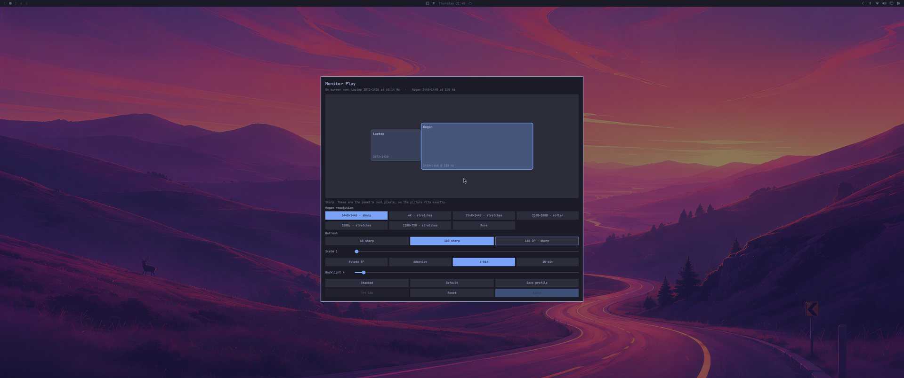

# Monitor Play

Arrange the laptop and external monitors on [Omarchy](https://omarchy.org).
Drag the screens, pick a resolution and refresh rate, and apply. The same
settings are a JSON API, so an agent can read and change the layout without
opening the window.



Each mode is marked with what it does on that panel:

- **sharp** — the panel's real pixels
- **softer** — the same shape, with fewer pixels
- **stretches** — a different shape, so the picture is stretched or gets bars

Modes the screen does not accept are rolled back.

## Install

This is a normal Omarchy shell plugin (a git repo with `manifest.json` at the
root). Add it, then run `install.sh` once for the command, menu entry, and
app launcher (`omarchy plugin add` never runs install hooks):

```bash
omarchy plugin add https://github.com/shubharthaksangharsha/monitor-play --enable
~/.config/omarchy/plugins/monitor.play/install.sh
```

Open **Trigger → Hardware → Monitor Play**, or run `monitor-play`.

Update later with:

```bash
omarchy plugin update monitor.play
~/.config/omarchy/plugins/monitor.play/install.sh
omarchy restart shell
```

`./uninstall.sh` removes the launcher and menu entry and leaves your Hyprland
layout alone. `omarchy plugin remove monitor.play` deletes the plugin checkout.

## Use

Drag a screen to place it. The laptop can sit on either side; there is no
separate left/right button. **Stacked** puts one above the other. **Default**
restores the saved profile. **Save profile** stores the current arrangement as
that default. **Try 10s** applies a change and puts the previous layout back
after 10 seconds. **Apply** keeps it.

Backlight is the monitor's own brightness (0–100) and updates when you release
the slider. Scale updates the preview immediately and takes effect on Apply.

## Agent API

`monitor-play` with no arguments opens the window. Anything else is the API.
Every command prints one JSON object on stdout.

List the tools, with the input each one accepts:

```bash
monitor-play api tools
```

Read what is on screen now. `confirmedHz` is the refresh Hyprland is actually
driving, and each mode includes `fit` (`sharp`, `softer`, or `stretches`):

```bash
monitor-play api get
```

Change one screen and leave everything else as it is. This example sets the
Kogan to its sharp 100 Hz mode:

```bash
monitor-play api set '{"screens":[{"name":"HDMI-A-1","mode":"3440x1440@100"}]}'
```

Useful fields on a screen: `name`, `mode` (`3440x1440@100` or `preferred`),
`resolution` plus `refresh`, `scale`, `x`, `y`, `transform` (0–3), `vrr`,
`bitdepth` (8 or 10), `brightness` (0–100).

Other commands:

```bash
monitor-play api defaults
monitor-play api save
monitor-play api save '{"screens":[{"name":"HDMI-A-1","mode":"3440x1440@100"}]}'
monitor-play api try '{"seconds":10,"screens":[{"name":"HDMI-A-1","mode":"2560x1080@144"}]}'
monitor-play api brightness '{"screens":[{"name":"HDMI-A-1","brightness":40}]}'
monitor-play api set '{"preset":"default"}'
monitor-play api set '{"dryRun":true,"screens":[{"name":"HDMI-A-1","mode":"1920x1080@120"}]}'
```

`try` applies a layout, waits, then restores the previous one. `brightness`
changes backlight only and does not reload Hyprland. `dryRun` prints the
config it would write and changes nothing. `preset` can be `default`,
`laptop-left`, `laptop-right`, or `stacked`.

A tool call is: run the command, read the JSON, and treat `"ok": false` as a
failure. The error text is also on stderr. Do not parse Hyprland's own output
when this JSON is available.
